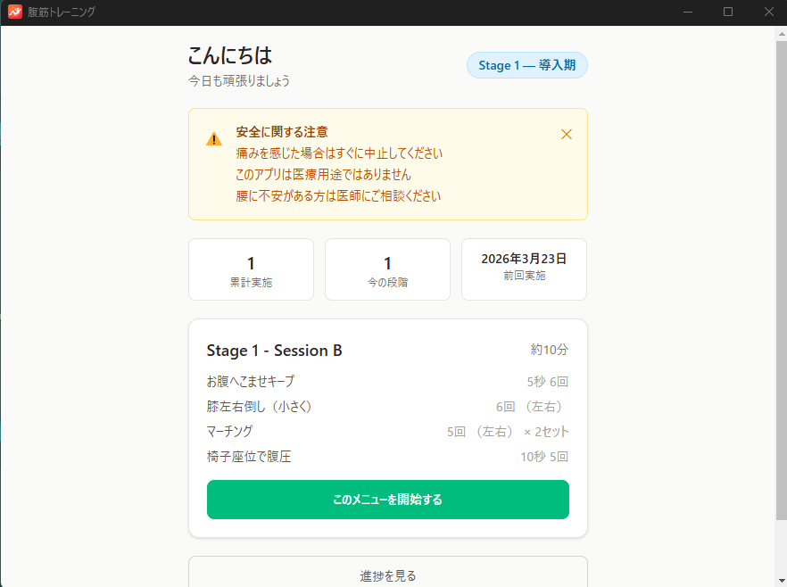

# 腹筋トレーニング支援アプリ

腹筋が極端に弱いユーザー向けの段階的な体幹トレーニング支援デスクトップアプリです。

## 特徴

- 最小負荷から始められる 3 段階のプログラム
- 1 回 10〜15 分で完了する短時間設計
- A/B セッションの自動ローテーション
- 進行条件を満たすと次の段階への推奨を表示
- ローカル保存で完全オフライン動作

## 更新配信

GitHub Releases を利用した自動更新に対応しています。


## データ保存場所

ユーザーデータは Electron の `userData` ディレクトリに保存されます。Windowsでの保存先は次のとおりです。

```
%APPDATA%/ab-training-app/progress.json
```

## 注意事項

- このアプリは医療用途ではありません
- 痛みを感じた場合はすぐに中止してください
- 腰に不安がある方は医師にご相談ください

## 問い合わせと開発参加

不具合や操作の相談は[サポート](SUPPORT.md)、開発参加は[CONTRIBUTING.md](CONTRIBUTING.md)、脆弱性の扱いは[SECURITY.md](SECURITY.md)を参照してください。

## ライセンス

[MIT](LICENSE)


## 開発・運用の知見

開発環境、内部構成、検証コマンドと運用上の注意は [findings.md](findings.md) を参照してください。更新・復旧の手順と検証記録は、同ファイルから案内しています。
